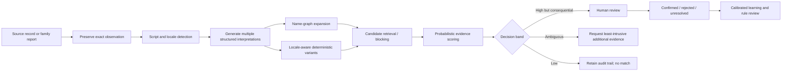

# Cross-Border Name Intelligence for Missing-Person Search

**Concept and option analysis**  
**Status:** Research concept — not an operational identification system  
**Prepared:** 19 October 2026  
**Working title:** **NameBridge**

---

## Executive recommendation

Build a **hybrid, culturally aware name-intelligence layer** that combines:

1. a **typed, provenance-bearing knowledge graph of name relationships**;
2. **locale- and script-aware normalization and transliteration**;
3. **probabilistic entity resolution using names plus non-name evidence**;
4. a separate **relationship graph** for relatives, households, locations, institutions and events;
5. **human review, calibrated uncertainty and an explicit ability to abstain**; and
6. humanitarian-grade controls for privacy, access, retention and misuse.

This is the highest-ranked approach because names alone cannot establish identity or kinship. The system should use names to **expand candidate recall**, then use dates, places, family relationships, documents, contact details, migration history, photographs or authorized biometrics to rank and corroborate candidates.

The central product idea is therefore not a universal “name matcher.” It is an **evidence-constrained candidate discovery system**:

> Preserve every observed form of a name, generate culturally plausible variants through a sourced graph, retrieve candidates broadly, score the complete evidence probabilistically, and route consequential matches to trained human reviewers.

### Ranked approaches

| Rank | Option | Weighted score* | Recommendation |
|---:|---|---:|---|
| **1** | **Hybrid name knowledge graph + probabilistic entity resolution + human review** | **4.63 / 5** | **Build this**. Best balance of recall, explainability, extensibility and safety. |
| **2** | Probabilistic linkage with locale-specific preprocessing, without a full graph | 4.11 / 5 | Best MVP core if resources are limited; design the schema so a graph can be added. |
| **3** | Graph-assisted search expansion only | 3.82 / 5 | Useful discovery service, but insufficient to assert identity. Deploy only as a candidate generator. |
| **4** | Commercial entity-resolution platform plus a custom cultural-name layer | 3.44 / 5 | Fast pilot option; evaluate transparency, data residency, humanitarian licensing and regional bias. |
| **5** | Deterministic rules, transliteration and phonetic matching | 3.42 / 5 | Keep as an explainable baseline and blocking mechanism, not as the production decision engine. |
| **6** | LLM-first or biometrics-first identification | 2.07 / 5 | Do not use as the primary architecture. LLMs may assist research; biometrics may corroborate under strict authority and safeguards. |

\*Scores are design judgments, not measured performance. Criteria and weights: expected missing-person utility 30%, feasibility 20%, explainability 15%, privacy/safety 20%, and maintainability 15%.

---

## 1. The problem is larger than spelling variation

Cross-border search fails when systems treat a name as a stable Western-style `given_name + family_name` string. A person’s recorded name can vary because of:

- script and romanization;
- language-specific sound correspondence;
- name order;
- mononyms or multiple given/family names;
- patronymics, matronymics, teknonyms and lineage chains;
- non-hereditary names;
- gender, case or grammatical inflection;
- particles such as *al-*, *bin*, *bint*, *de*, *da*, *van*, *von* and *ap*;
- nicknames, religious names, initiation names, married or previous names;
- administrative truncation, data-entry conventions and passport machine-readable zones;
- historical cognates and etymological descendants; and
- errors introduced by memory, oral reporting, OCR, handwriting or interpretation.

The W3C’s survey of international names documents mononyms, patronymics, variable name order, multiple surnames, gendered forms, non-shared family names, nicknames, pronunciation fields and non-Latin scripts. It explicitly warns against assuming that family members share a surname or that a full name can be parsed reliably from one string.[^w3c]

Unicode CLDR provides a strong model for **formatting structured names** across locales, including multiple surnames, mononyms and patronymic structures. It also explicitly places parsing of an arbitrary name string and combining alternative names outside its current scope. CLDR is therefore a foundation for representation and display, not a complete identity-resolution solution.[^cldr]

### A necessary distinction: identity, name and relationship

The proposed system needs three separate concepts:

1. **Person identity** — the real-world individual being sought.
2. **Name expression** — an observed or generated way of referring to a person.
3. **Relationship** — parent, sibling, spouse, household member, travel companion, witness, institution, location or event.

A shared name does not prove two records refer to the same person. A different surname does not prove that two people are unrelated. This distinction is especially important for family tracing.

---

## 2. Interpreting the motivating examples correctly

### 2.1 Santiago, Sant Iago and Yaʿakov/Jacob

The example is valuable, but it requires typed edges rather than an undifferentiated synonym list.

A useful graph path would be:[^santiago]

```text
Santiago
  └─ historically_formed_from → Sant Iago / Sant Yago
       ├─ contains_title → Sant (“saint”)
       └─ contains_name → Iago / Yago
            └─ historical_cognate_of → Iacobus / Iakobos / Yaʿakov
                 ├─ cognate → Jacob / Jacobo / Jakob
                 ├─ cognate → James / Jacques / Giacomo
                 └─ cognate → Jaime / Tiago / Diogo (with language- and history-specific paths)
```

The key safety point is that **etymological relation is not the same as a contemporary alias**. A modern Santiago should not automatically match every James, Jacob, Jacques or Yaʿakov. The edge can expand a search when geography, language, time period or other evidence supports it, but it should carry a lower and context-dependent weight than an attested alias, passport spelling or self-reported form.

This illustrates why every graph edge needs a relation type, language/region, time applicability, provenance and confidence.

### 2.2 Rwanda — family relationships without shared surnames

Human Rights Watch notes that most Rwandans have names particular to themselves and do not share a common family name; two people sharing a name is usually coincidence rather than evidence of relationship.[^hrw-rwanda] Secondary synthesis drawing on World Bank and onomastic sources similarly describes Rwandan surnames as generally non-hereditary and siblings as usually having different names.[^rwanda-names]

Operational consequence: a Rwanda-focused sibling search should not use surname agreement as a positive requirement. It should emphasize parent or caregiver names, household composition, village/cell/sector, school, faith community, displacement event, travel group, photographs, ages and a family narrative.

### 2.3 Burundi — treat the parallel claim as a research hypothesis

Kinyarwanda and Kirundi naming traditions are closely related subjects in the onomastic literature, but the accessible sources reviewed for this brief did **not** establish the blanket claim that Burundian siblings never share a surname. The project should record this as a **country-specific evidence gap**, commission review by Burundian/Kirundi experts and test actual administrative records before encoding a rule.

This is an important governance lesson: regional proximity must not be converted into an assumed naming rule. Rules should be attached to a cited source and a confidence level, not merely to a country code.

---

## 3. Representative international patterns the system must handle

This table is a design taxonomy, not an exhaustive country guide. A single country may contain several systems, and an individual may use different forms in different settings.

| Pattern | Illustrative contexts | Resolution implication |
|---|---|---|
| **Multiple inherited surnames** | Spanish- and Portuguese-speaking contexts | Preserve surname components and particles separately; do not drop the second surname or assume the last token is the primary surname. |
| **Non-hereditary or individual names** | Rwanda; mononymic practices in parts of Indonesia and South India | Do not infer family relationship from surname agreement or disagreement; permit one-part names. |
| **Patronymic/matronymic names** | Icelandic, Arabic, Somali, Ethiopian/Eritrean, South Asian and Slavic forms | Model parent-derived components explicitly; a component may be relational evidence rather than a family name. |
| **Lineage chains** | Arabic naming traditions and some East African contexts | Parse *bin/ibn/bint* and sequence positions without treating every token as a surname. |
| **Surname-first order** | Chinese, Korean, Japanese, Hungarian and many official African records | Store order as observed; do not infer semantics from token position alone. |
| **Generational names** | Some Chinese naming practices | A shared generation component can be family evidence, but only where the practice is attested. |
| **Gendered or inflected forms** | Russian and other Slavic, Baltic and Greek contexts | Match a stem with morphology-aware transformations; retain the exact legal form. |
| **Particles and joined/separated forms** | *al Rashid/al-Rashid*, *de la Cruz*, *van den Berg* | Generate punctuation and spacing variants, but preserve particles because they may affect meaning, sorting or identity. |
| **Multiple valid romanizations** | Arabic, Cyrillic, Greek, Persian, Hebrew, Chinese, Japanese and Indic scripts | Generate several standards and common local/passport variants; record the transformation path. |
| **Pronunciation ambiguity** | Japanese kanji and other logographic contexts | Store native script and supplied reading/pronunciation; romanization may collapse distinct names. |
| **Everyday nickname unlike legal name** | Thai usage and many other cultures | Treat an attested social name as a first-class alias with source and context. |
| **Administrative truncation/substitution** | Passport MRZs, visa systems and legacy ASCII databases | Keep the source field, field length and document type; reconstruct only as a hypothesis. |
| **Name change over time** | Marriage, adoption, religious conversion, safety-related changes and gender transition | Model validity intervals and do not expose protected prior names without authorization. |
| **Historical/etymological cognates** | Santiago–Iago–Jacob-type paths | Use for low-weight query expansion, not automatic equivalence. |

The 2006 UK/INTERPOL naming-practices guide remains useful as a structured reference for typical components, family relationships, titles, distinctive customs and English spelling variation across the systems it covers. It is dated and incomplete, so every country rule should be revalidated with current local expertise.[^uk-names]

---

## 4. Existing operational context

The proposed service should complement, not replace, established authorities and tracing networks.

- INTERPOL Yellow Notices are global police alerts for missing persons and can also help identify a person who cannot identify themselves. INTERPOL reports 3,345 Yellow Notices issued in 2024.[^interpol]
- NamUs is a centralized U.S. system for missing, unidentified and unclaimed persons. It combines case records with authorized access to dental, fingerprint, DNA, anthropological and other forensic services; public entries are vetted with the investigating agency.[^namus]
- The ICRC’s Restoring Family Links work searches for missing people, restores contact and reunites families through an international humanitarian network.[^rfl]
- UNHCR treats registration as an ongoing identity-management process that records biographical relationships and changes over time, with photographs, biometrics and unique identifiers used in its authorized context.[^unhcr-registration]

The design opportunity is a **federated search and evidence layer** that can improve candidate discovery across differently structured records while respecting the authority, purpose and disclosure rules of each contributing organization.

---

## 5. Proposed architecture

### 5.1 Two graphs, not one

Maintain strict separation between:

#### A. Public/curated Name Knowledge Graph

Contains cultural and linguistic knowledge, not case-person PII.

**Node types**

- `NameForm`: exact string in a script
- `NameConcept`: a language/culture-specific name concept
- `Morpheme`: a meaningful component or particle
- `Script`, `Language`, `Locale`, `Region`
- `Rule`: a transformation or naming-practice rule
- `Source`: publication, dataset or expert attestation

**Edge types**

- `transliteration_of`
- `romanization_variant_of`
- `orthographic_variant_of`
- `phonetic_variant_of`
- `nickname_of`
- `formal_form_of`
- `historical_cognate_of`
- `etymologically_derived_from`
- `contains_morpheme`
- `inflected_form_of`
- `married_or_previous_form_of` — only as a general rule in the public graph, never a person-specific fact
- `commonly_confused_with`
- `not_equivalent_to` / negative constraint

**Required edge metadata**

```yaml
source_name: string
source_url: uri
source_excerpt_or_locator: string
relation_type: controlled_vocabulary
source_language: BCP-47 tag
applicable_languages: [BCP-47]
applicable_regions: [ISO-3166 or custom cultural region]
time_period: optional interval
confidence: 0.0-1.0
confidence_basis: attested | statistical | expert | generated | disputed
reversible: true | false | unknown
review_status: proposed | reviewed | deprecated
reviewer_role: linguist | community_expert | investigator | data_steward
license: SPDX-or-text
```

A generated edge must never silently become an authoritative edge. LLM suggestions should enter as `proposed`, with a source-finding and review queue.

#### B. Protected Case Identity and Relationship Graph

Contains people, observations and case relationships under role-based access.

**Node types**

- `PersonHypothesis`
- `ObservedName`
- `CaseRecord`
- `Document`
- `Location`
- `Event`
- `Organization`
- `ContactPoint`
- `FamilyOrHouseholdGroup`
- `MediaObject`
- `BiometricReference` — preferably a pointer to an authorized system, not raw biometric data

**Edge types**

- `same_person_candidate`
- `reported_parent_of`, `reported_sibling_of`, `reported_spouse_of`
- `member_of_household`
- `seen_at`, `registered_at`, `travelled_with`
- `attended_school`, `associated_with_organization`
- `name_observed_in_document`
- `corroborated_by` / `contradicted_by`

Each fact should retain who asserted it, when, under what authority, its sensitivity, its confidence and any restrictions on sharing.

### 5.2 Processing pipeline



### 5.3 Preserve first; normalize into parallel fields

Never overwrite the source name. Store at least:

```yaml
observed_full_name: exact source text
observed_script: ISO 15924
source_language: BCP-47 or unknown
source_country: optional
source_type: oral_report | form | passport_viz | passport_mrz | registry | flyer | other
source_date: optional
source_field_label: exact label
source_order: as_observed
written_by: self | other | unknown          # added 28 Oct 2026 (§5.4A)
recorded_by_convention: BCP-47              # required when written_by is other
native_script_form: optional
reported_pronunciation: optional
preferred_form: optional
structured_interpretations:
  - parts: [...]
    interpretation_confidence: 0.0-1.0
transforms:
  - output: string
    method: ICU transform / ICAO MRZ / curated rule / attested alias
    parameters: {...}
    lossy: true | false | unknown
```

ICAO travel-document standards and systems based on machine-readable passport fields are useful sources of observed aliases, but the machine-readable form can remove punctuation or diacritics, impose order and truncate fields. DHS guidance accordingly treats a passport MRZ as a preferred source for order and transliteration while acknowledging that it may differ from the person’s claimed name.[^dhs]

### 5.4 Transliteration as a set of hypotheses

Unicode ICU offers script/language transforms, normalization and chained transliteration useful for cross-script search. ICU cautions that transliteration is not translation and that inverse transforms do not guarantee a complete reversal.[^icu]

For each observed name, generate:

1. Unicode-normalized native-script form;
2. diacritic-preserving and diacritic-folded search forms;
3. relevant standard transliterations;
4. passport/MRZ form where applicable;
5. country- or community-specific common romanizations;
6. phonetic keys appropriate to the language, if validated; and
7. curated aliases, nicknames and historical forms from the graph.

Do **not** collapse these into one canonical Latin string. A lossy transliteration can cause both false positives and false negatives.

### 5.4A Sound layer: names told aloud (added 28 Oct 2026)

*Proposed by the user (28 Oct 2026); widened the same day.* Many names in this corridor are **written down by someone other than their owner**:

- **children** who cannot yet read;
- **adults who cannot read or write.** Roughly one adult in four to one in three in the corridor countries (UNESCO, 2022: Burundi 75.5% literate, Malawi 68.1%, DRC 80.5% or 68.5% depending on the series). Women and older people, the parents and grandparents who search, are much less literate (Burundi women 69.4%; Burundi adults in 1990, 37%) (`RESEARCH_LOG.md`, 28 Oct);
- **literate people** whose names are typed by a registration clerk, caseworker or interpreter who speaks another language. This is the normal case at registration, whatever the person's literacy.

The writer hears the name through their own language and accent and spells it with their own habits, so the same name can arrive spelled in ways no spelling rule predicts. Sound is therefore a **core comparison**, not an extra: NameBridge compares names **by sound** in three steps, each taken from the language pack:

1. **Sound inventory.** The language's sounds, with digraphs that are a single sound kept as one unit: prenasalised *mb, nd, ng, nj, nk, mp, nt, nz*; palatal *cy, ry*; labialised *bw, rw, sw*; *sh, pf, ts* (*Kinyarwanda and Kirundi Comparative Grammar*, 2007, ch. 2; `RESEARCH_LOG.md` [P1]). A name is read into this sound sequence, not split letter by letter.
2. **Writing conventions.** How each sound is spelled by someone writing in Kirundi, Kinyarwanda, French, English, Swahili or Chichewa: e.g. /w/ as *w* or French *ou*; /ʃ/ as *sh* or French *ch*; /tʃ/ as Kirundi *c*, English *ch* or French *tch*; /dʒ/ as *j* or French *dj* (French orthography). The case record stores the convention of the person who wrote the name (`recorded_by_convention`), so the matcher can work back from their spelling to the possible sounds.
3. **Listener confusions.** Sounds that are easily heard or written one for another, with a cost per pair: *r/l* are one sound in Rwanda-Rundi, and *l* is kept only in some proper nouns (*Kigali*) by Rwandan spelling rules; vowel length and tone are not written; *y* and *w* glides may be dropped or added (*-iye* / *-ie*). Pairs without a source enter as `hypothesis` and stay low-weight until checked.

Matching then uses the sound sequence as one more comparison, next to spelling, with confusion-weighted costs. It never replaces the other evidence: sound alone, like a name alone, never confirms anyone (§5.6). English-based phonetic codes such as Double Metaphone, used by the CPIMS+ baseline, were built for English and are expected to do worse on these names; the benchmark measures that (§9).

### 5.5 Candidate retrieval before final scoring

Use multiple blocking/index strategies in parallel:

- exact native-script or attested alias;
- transliterated n-grams;
- token and token-order variants;
- graph-neighborhood expansion with maximum path cost;
- phonetic keys selected by language;
- date-of-birth ranges rather than exact dates where records are uncertain;
- place hierarchies and historical place names;
- parent/relative/household/event anchors; and
- document or contact identifiers, where lawfully available.

The goal of blocking is high recall. Final scoring then suppresses weak candidates.

### 5.6 Probabilistic evidence model

Use a Fellegi–Sunter-style model or another calibrated probabilistic linker as the interpretable starting point. Splink implements this approach at scale and supports term-frequency adjustments, custom fuzzy comparisons and explainable diagnostics. Its own documentation stresses that person linkage works best with several partly independent fields, such as name, date of birth and city, rather than a name alone.[^splink]

A conceptual score is:

```text
P(same person | name evidence,
                    date/age evidence,
                    place-time evidence,
                    family/household evidence,
                    document/contact evidence,
                    media/biometric evidence,
                    source reliability)
```

Important rules:

- Calibrate by language, script, region, source type and time period where data permits.
- Apply term-frequency adjustments: agreement on a rare name is more informative than agreement on a very common one.
- Represent missing, uncertain and contradictory values explicitly.
- Use both positive and negative evidence.
- Prevent one graph path from being counted repeatedly as independent evidence.
- Set different thresholds for **retrieval**, **review priority** and **operational confirmation**.
- Never let a name-only score trigger a consequential action.

### 5.7 Human review and active learning

Reviewers should see:

- source records side by side;
- the exact transformation and graph path that created the candidate;
- field-level agreement/disagreement weights;
- source quality and date;
- alternative parses;
- sensitive-field access warnings; and
- actions: `same`, `different`, `possible`, `insufficient evidence`, `request specific evidence`.

Reviewer decisions can improve ranking, but only after quality checks for label disagreement and regional bias. A cultural or linguistic subject-matter expert should review rules; an investigator or authorized caseworker should review identity decisions.

---

## 6. Why the hybrid approach ranks first

### Evaluation criteria

| Criterion | Weight | What “good” means |
|---|---:|---|
| Missing-person utility | 30% | High top-K recall without overwhelming reviewers; supports same-person and family-network discovery. |
| Feasibility | 20% | Can be piloted with available open standards and entity-resolution software. |
| Explainability | 15% | Every candidate can be traced to observations, transformations, graph edges and evidence weights. |
| Privacy and safety | 20% | Minimizes PII, separates public knowledge from case data, supports federated access and abstention. |
| Maintainability | 15% | Rules and data can be versioned, cited, reviewed and extended by region. |

### Option scoring

| Option | Utility | Feasibility | Explainability | Privacy/safety | Maintainability | Weighted |
|---|---:|---:|---:|---:|---:|---:|
| Hybrid KG + probabilistic ER + review | 5.0 | 4.0 | 5.0 | 4.5 | 4.5 | **4.63** |
| Probabilistic ER + locale preprocessing | 4.2 | 4.7 | 4.2 | 4.0 | 3.2 | **4.11** |
| Graph-assisted search expansion | 4.0 | 4.0 | 4.4 | 3.3 | 3.3 | **3.82** |
| Commercial ER + custom cultural layer | 4.0 | 4.2 | 2.6 | 2.8 | 3.0 | **3.44** |
| Deterministic rules/transliteration | 2.7 | 4.5 | 4.8 | 3.5 | 1.9 | **3.42** |
| LLM-first or biometrics-first | 3.0 | 2.0 | 1.5 | 1.0 | 2.3 | **2.07** |

### Option notes

#### 1. Hybrid knowledge graph + probabilistic linkage + review — recommended

**Strengths:** combines cultural knowledge with record-level evidence; explainable; allows low-weight historical relations without turning them into synonyms; supports incremental regional expansion.  
**Weaknesses:** highest curation and governance burden.  
**Best use:** production direction after a bounded pilot.

#### 2. Probabilistic linkage without a full graph — recommended MVP core

**Strengths:** fast to implement; mature statistical foundation; can measure precision/recall and reviewer workload.  
**Weaknesses:** variant generation can become a collection of opaque rules; less reusable linguistic knowledge.  
**Best use:** first pilot if architecture preserves provenance and can accept graph-derived features later.

#### 3. Graph-assisted search expansion only

**Strengths:** directly addresses Santiago-like paths; easy to explain why a candidate surfaced.  
**Weaknesses:** a name graph cannot distinguish people with common names and does not prove kinship.  
**Best use:** discovery API or analyst tool, explicitly labelled as candidate generation.

A closely aligned precedent is Anthroponym, which describes itself as a typed, sourced, confidence-scored graph of nicknames, spellings and cross-lingual variants with provenance. Its workspace is private, so it should be treated as a precedent to evaluate, not an assumed dependency.[^anthroponym]

#### 4. Commercial entity resolution

Potential products include Senzing-style entity resolution and specialized name APIs.  
**Strengths:** faster integration and operational support.  
**Weaknesses:** opaque matching knowledge, uncertain coverage by region, recurring cost, vendor dependency and possible data-residency problems.  
**Gate:** run the same multilingual benchmark against the open hybrid prototype; require field-level explanations and no vendor training on case data.

#### 5. Deterministic rules and phonetic matching

**Strengths:** transparent and cheap; good for preprocessing, blocking and regression tests.  
**Weaknesses:** rules interact combinatorially, phonetic algorithms are language-specific, and a single threshold is brittle.  
**Use:** baseline only.

#### 6. LLM-first or biometrics-first

LLMs can propose parses, identify possible name traditions, summarize evidence and draft candidate graph edges. They should not invent aliases or decide identity. Biometrics can be powerful corroboration in an authorized forensic or registration process, but humanitarian deployments create high-consequence privacy, coercion and breach risks. ICRC policy requires biometric processing to follow “do no harm,” humanitarian purpose and data-protection rules.[^icrc-biometrics]

---

## 7. Candidate technology and data components

| Layer | Candidate | Recommended role | Caveat |
|---|---|---|---|
| Name representation | Unicode CLDR Person Names | Locale-aware structure and display | Does not parse arbitrary names or resolve identity. |
| Unicode handling | ICU transforms, normalization and collation | Script conversion and search variants | Transformations may be ambiguous or non-reversible. |
| Travel-document forms | ICAO Doc 9303 and MRZ conventions | Generate/document official machine-readable variants | MRZ forms can be lossy and truncated. |
| Probabilistic linkage | Splink | MVP linkage engine and explainable benchmark | Requires multiple useful attributes; custom cultural comparisons still needed. |
| Supervised linkage | Urban Labs Name Match | Compare a supervised pipeline with blocking/modeling/clustering | Validate maintenance, scale and multilingual behavior. |
| General knowledge graph | Wikidata/YAGO | Seed labels, aliases and cross-language entity evidence | Person-entity aliases are not the same as a curated name-etymology graph. |
| Wikidata alias extraction | Aleph `synonames` | Experimental query expansion | Inspect recency, coverage, error propagation and license obligations. |
| Name graph precedent | Anthroponym | Evaluate graph schema and provenance model | Private workspace; data coverage is not publicly inspectable. |
| Open name datasets | Onomaverse | Candidate transliteration/equivalence benchmark source | Very new; independently validate provenance, accuracy and regional coverage before case use. |
| Curated etymology | Licensed dictionaries/onomastic sources | Sourced historical edges | Licensing may prohibit bulk redistribution. |
| Privacy-preserving linkage | Bloom-filter/secure-computation research and modern PPRL | Later federation across organizations | Bloom-filter designs require cryptographic review; older schemes can leak information if poorly configured. |

YAGO is a broad knowledge base about people, places and organizations and is useful as a general entity/alias source.[^yago] Cross-lingual knowledge-graph alignment research shows that structure and attributes can be combined to align entities across languages, but this is an advanced enhancement rather than the first missing-person MVP.[^xling-kg]

Onomaverse currently advertises open datasets covering relative frequencies, transliterations and a name-equivalence graph under CC BY 4.0. Because the repository is new and its frequency estimates are explicitly coverage-limited rather than census data, it should enter through a formal source-quality review.[^onomaverse]

---

## 8. Privacy, safeguarding and misuse controls

A system that helps families can also help stalkers, traffickers, abusive relatives, hostile governments or armed groups locate vulnerable people. Safety must be an architectural property.

### Non-negotiable controls

1. **Purpose limitation:** missing-person tracing, family restoration or authorized identification only.
2. **Role separation:** public search, family/advocate access, humanitarian caseworker access and law-enforcement access must expose different data. *Decided 28 Oct 2026 (gate G2):* in NameBridge, law enforcement and governments have **no access role at all**; they are not users (`SCOPE.md` §2).
3. **Data minimization:** collect the minimum attributes needed for the current match decision. NIST identity-resolution guidance similarly emphasizes the minimum set necessary to distinguish a person in a defined population and context.[^nist]
4. **Consent and lawful basis:** record why each source may be used and with whom it may be shared.
5. **No public person graph:** the cultural Name Knowledge Graph can be public; case-person identity and relationship graphs must be protected.
6. **No autonomous disclosure:** a high score does not reveal a location or contact details.
7. **Protected-person flags:** suppress or specially route cases involving minors, trafficking, domestic violence, asylum, witness protection or a person who may not wish to be found.
8. **Progressive disclosure:** reviewers first see the minimum evidence; sensitive details open only when necessary.
9. **Audit and redress:** immutable access logs, correction workflow, match challenge and deletion/retention controls.
10. **Security:** encryption, tenant isolation, regional hosting where required, key separation, breach response and regular abuse testing.
11. **Model governance:** per-region error reporting, drift review, expert sign-off on new rules and versioned reproducibility.
12. **No name-based inference of ethnicity, religion or gender as fact:** these may be weak search hypotheses only, never asserted personal attributes.

The ICRC’s data-protection handbook frames protection of personal data as part of protecting life, integrity and dignity and calls out digital identity, AI and social media as areas with material humanitarian risk.[^icrc-handbook]

### Federated matching

Where organizations cannot pool raw data, introduce privacy-preserving record linkage only after the centralized pilot is well understood. Research demonstrates approximate multi-party linkage over protected quasi-identifiers, but also identifies a three-way trade-off among privacy, linkage quality and scalability.[^pprl]

Do not assume that Bloom filters alone provide adequate protection. Commission current cryptographic review and consider private set intersection, trusted execution environments or secure multiparty computation based on the threat model.

---

## 9. Evaluation plan

### 9.1 Gold-standard corpus

Create a consented or safely synthetic benchmark with reviewed true matches, non-matches and family relationships across priority corridors. Each region should include:

- native-script/Latin pairs;
- multiple romanizations;
- name-order changes;
- punctuation and spacing changes;
- mononyms;
- multiple surnames;
- patronymics and lineage chains;
- non-hereditary family names;
- nicknames and previous names;
- OCR and handwriting errors;
- incomplete dates and place changes;
- hard negatives with common names; and
- adversarially similar records.

Synthetic examples are useful for coverage, but the decisive benchmark must contain de-identified or tightly governed real error patterns.

### 9.2 Primary metrics

- **Candidate recall@K:** proportion of true persons/relatives present in the first K candidates.
- **Pairwise precision, recall and F1.**
- **False-match rate at the operational review threshold.**
- **False-non-match rate**, especially by language/script/region.
- **Calibration:** whether a 0.8 score corresponds to about an 80% observed match rate within the evaluated population.
- **Abstention coverage and accuracy.**
- **Reviewer minutes per resolved case.**
- **Number of additional sensitive fields requested per case.**
- **Transformation-path quality:** proportion of surfaced candidates with a valid, understandable explanation.
- **Fairness slices:** error rates by script, region, source type, gender where ethically and lawfully measured, and record completeness.

### 9.3 Evaluation rules

- Split related records by person/family so the same identity cannot leak into train and test.
- Use temporal holdouts to test new migration or administrative patterns.
- Measure name-only retrieval separately from full-evidence resolution.
- Report performance by region; never publish only a global average.
- Benchmark deterministic, probabilistic, graph-assisted, commercial and hybrid systems on the same cases.
- Predefine the cost of false positives and false negatives for each workflow.

Probabilistic record linkage provides explicit tools for match weights, thresholds and linkage-error evaluation, while deterministic exact matching predictably loses records with spelling and formatting differences.[^prob-linkage]

---

## 10. Phased implementation roadmap

### Phase 0 — governance and corridor selection (2–4 weeks)

- Select one bounded cross-border corridor and two or three languages/scripts.
- Define users, authorities, harms and prohibited uses.
- Establish a community advisory group and linguistic review panel.
- Define data-sharing, retention, disclosure and incident-response rules.
- Produce a misuse/threat model and data-protection impact assessment.

**Exit:** approved purpose, test data, benchmark protocol and named data stewards.

### Phase 1 — name corpus and ontology (4–8 weeks)

- Implement the two-graph schema.
- Load Unicode/CLDR and ICU capabilities.
- Curate 2,000–10,000 high-value name relationships for the pilot corridor.
- Record negative constraints and ambiguous paths.
- Build the source, licensing and review workflow.

**Exit:** versioned graph with every edge sourced and confidence-scored.

### Phase 2 — linkage MVP (6–10 weeks)

- Preserve raw observations and create parallel normalized forms.
- Implement multi-strategy blocking.
- Train/configure a Splink baseline using name plus date/age, place and family/event evidence.
- Add graph-derived comparison features.
- Build an explanation-first review interface.

**Exit:** offline results against the gold set and no live case decisions.

### Phase 3 — shadow pilot (8–12 weeks)

- Run beside an existing authorized tracing workflow.
- Do not disclose or act on matches generated only by the system.
- Compare reviewer outcomes, time saved and candidates newly surfaced.
- Audit regional failure modes and protected-person scenarios.

**Exit:** pre-agreed minimum recall, false-match ceiling, calibration and safeguarding criteria.

### Phase 4 — controlled operational deployment

- Release to trained users with progressive disclosure.
- Add new regions through a formal “country/language pack” process.
- Introduce federated/PPRL matching only where agreements prohibit central pooling.
- Continuously monitor drift, abuse, appeal and correction.

### Final phase — free offer (added 19 Oct 2026; open source confirmed 28 Oct 2026)

*Confirmed 28 Oct 2026 (professor and user, gate G7):* NameBridge stays **open source**. There is no intention to sell it, because the work is humanitarian. Where it is useful and makes sense, a licence may be offered to an organisation.

The free offer below remains the plan. With a tested result in hand, the graph, packs, code and evaluation are offered free of charge to:

- **authorised tracing services** (e.g. ICRC Restoring Family Links, REFUNITE, UNHCR), which may run the matching system under the controls in §8; and
- **Fraternidade Sem Fronteiras (FSF)**, whose work with children in care (foster children, the Órfãos do Congo project) involves tracing relatives.

FSF is not an authorised tracing service, so its role is different:

- FSF **does not run the matching system** or hold a case graph (§8 controls 1, 2 and 5).
- FSF uses a short **intake guide** derived from the language packs: which names and relationship evidence to record when a child or family is looking for relatives (all names in any order, parents' or caregivers' names, village/colline, school, faith community, the place name as it was at the time; §2.2). It never records ethnicity or clan (§8 control 12).
- FSF **refers cases** to an authorised tracing service, such as the Red Cross, which does the matching.
- Every case involving a minor is a protected-person case (§8 control 7).

The timeline is an engineering estimate for planning, not a delivery commitment.

---

## 11. Country/language pack specification

Each expansion pack should contain:

```yaml
pack_id: rw-kiny-2026.1
languages: [rw]
scripts: [Latn]
regions: [RW]
name_structures:
  - description
  - source
  - confidence
order_rules: []
particles_and_morphemes: []
transliteration_rules: []
phonetic_rules: []
common_administrative_forms: []
phoneme_inventory: []          # sound layer, §5.4A (added 28 Oct 2026)
spelling_conventions: []
listener_confusions: []
relationship_implications:
  surname_agreement: weak | neutral | strong | context-dependent
  surname_disagreement: weak | neutral | strong | context-dependent
known_failure_modes: []
protected_or_sensitive_forms: []
benchmark_cases: []
reviewers: []
version: semver
```

The pack must distinguish cultural practice, legal-document practice and database convention. It must also support “unknown” and “disputed” rather than forcing a rule.

---

## 12. Immediate prototype backlog

### Must have

- exact preservation of source values;
- Unicode normalization without destructive replacement;
- native-script and Latin-script indexing;
- ICU-based transformations with transform-path logging;
- graph API returning typed paths and confidence;
- Splink baseline with field-level explanations;
- person and family/relationship views kept separate;
- reviewer queue with `unresolved` and `insufficient evidence` outcomes;
- country/language pack for the pilot;
- benchmark and regression suite;
- role-based access, logging and deletion/retention workflow.

### Should have

- geospatial and historical place-name graph;
- document field mapping for passport VIZ/MRZ and common registries;
- OCR-confidence ingestion;
- photo comparison only as an authorized external signal;
- active-learning queue for hard examples;
- privacy-preserving federation proof of concept.

### Should not have in the first release

- public reverse lookup of people;
- automatic identity confirmation;
- autonomous family relationship inference;
- open ingestion of scraped social-media PII;
- a universal ethnicity or gender classifier from names;
- raw biometric storage;
- unsourced LLM-generated name equivalences;
- a single global threshold.

---

## 13. Key research questions remaining

1. Which cross-border corridor offers a sufficiently representative but governable pilot?
2. What false-match risk is acceptable at candidate generation, reviewer prioritization and operational confirmation?
3. Which organizations can supply de-identified historical match outcomes for evaluation?
4. How should a person who does not wish to be located assert and enforce that preference?
5. Which relationship evidence is culturally meaningful in each pilot region?
6. How should oral testimony and uncertain dates be represented without falsely lowering source credibility?
7. Which name datasets can be redistributed, and which may only be queried under license?
8. Can country/language packs be stewarded by regional universities, diaspora groups and humanitarian organizations?
9. What current cryptographic protocol best fits federation among agencies with different threat models?
10. How will corrections propagate when a source system, graph edge or identity decision changes?

---

## 14. Repository note

*Corrected 19 Oct 2026.* An earlier version of this section said that `docs/SOLUTIONS.md` returned a 404. That was wrong: the file is in the public repository at [`docs/SOLUTIONS.md`](https://github.com/Ethical-Tech-CoLab/Fraternity/blob/main/docs/SOLUTIONS.md) (checked 19 Oct 2026). The Fraternity methodology is in `CONCEPT.md` and `RESEARCH_BACKGROUND_DOCUMENT.md`.[^fraternity-concept][^fraternity-background]

This document is the project's work from 19 Oct 2026; the week-by-week plan is in [`docs/TIMETABLE.md`](https://github.com/Ethical-Tech-CoLab/Fraternity/blob/main/docs/TIMETABLE.md). `SOLUTIONS.md` is kept for reference only. Its idea 2F (Open Great Lakes Names) was a narrower version of this concept, and its Great Lakes material can feed the pilot corridor.

---

## 15. Bottom line

The most effective approach is a **knowledge-graph-assisted probabilistic search system**, not a larger nickname table and not a universal fuzzy-name score.

The system should:

- expand names through typed, sourced and confidence-scored relationships;
- treat transformations as hypotheses rather than replacements;
- combine names with independent biographical, relational, geographic and temporal evidence;
- model same-person identity separately from kinship;
- preserve uncertainty and enable abstention;
- expose the path that produced every candidate;
- place trained human review before consequential action; and
- minimize and protect case data as rigorously as the matching logic is optimized.

This architecture directly supports the missing-person intent while avoiding the central failure mode of cross-border identity systems: mistaking a culturally convenient name model for the person.

---

## Sources

[^w3c]: W3C Internationalization, [“Personal names around the world”](https://www.w3.org/International/questions/qa-personal-names), updated 17 August 2011.
[^cldr]: Unicode Consortium, [Unicode LDML Part 8: Person Names, Version 48.2](https://www.unicode.org/reports/tr35/tr35-personNames.html).
[^santiago]: [“Santiago (name)”](https://en.wikipedia.org/wiki/Santiago_%28name%29), historical derivation from *Sant Iago/Sant Yago* and the Hebrew *Ya'akov* through Greek/Latin forms; use as an etymological lead rather than identity evidence.
[^hrw-rwanda]: Human Rights Watch, [“Language, Spelling and Names”](https://www.hrw.org/reports/1999/rwanda/Geno1-3-08.htm), *Leave None to Tell the Story*, March 1999.
[^rwanda-names]: [“Rwandan names”](https://en.wikipedia.org/wiki/Rwandan_names), synthesis with citations to World Bank ID4D, onomastic research, Human Rights Watch and identity-document sources. Use as a discovery aid and verify against its primary citations.
[^uk-names]: United Kingdom / INTERPOL, [*A Guide to Names and Naming Practices*](https://www.fbiic.gov/public/2008/nov/Naming_practice_guide_UK_2006.pdf), March 2006.
[^interpol]: INTERPOL, [“Yellow Notices”](https://www.interpol.int/How-we-work/Notices/Yellow-Notices).
[^namus]: U.S. National Institute of Justice, [“National Missing and Unidentified Persons System”](https://nij.ojp.gov/namus), 19 September 2025.
[^rfl]: International Committee of the Red Cross, [“Reconnecting families”](https://www.icrc.org/en/what-we-do/reconnecting-families).
[^unhcr-registration]: UNHCR, [“Registration as an Identity Management Process”](https://www.unhcr.org/registration-guidance/chapter5/registration/).
[^dhs]: U.S. Department of Homeland Security, [“Name Standards”](https://studyinthestates.dhs.gov/sevis-help-hub/sevis-basics/system-data-entry-standards/name-standards), 14 November 2022.
[^icu]: Unicode ICU, [“Transforms”](https://unicode-org.github.io/icu/userguide/transforms/general/).
[^splink]: Splink, [“Fast, accurate and scalable probabilistic data linkage”](https://moj-analytical-services.github.io/splink/index.html).
[^anthroponym]: Anthroponym, [“A graph of personal names”](https://anthroponym.dev/).
[^icrc-biometrics]: ICRC, [“Policy on the Processing of Biometric Data by the ICRC”](https://missingpersons.icrc.org/library/policy-processing-biometric-data-icrc), 2019.
[^yago]: YAGO Project, [“YAGO: A High-Quality Knowledge Base”](https://yago-knowledge.org/).
[^xling-kg]: Wang et al., [“Cross-lingual Knowledge Graph Alignment via Graph Convolutional Networks”](https://aclanthology.org/D18-1032/), EMNLP 2018.
[^onomaverse]: Onomaverse, [“Onomaverse Names Datasets”](https://github.com/onomaverse/datasets), CC BY 4.0, accessed 19 October 2026.
[^nist]: NIST, [SP 800-63A: Identity Resolution and Evidence Collection](https://pages.nist.gov/800-63-3-Implementation-Resources/63A/resolution/).
[^icrc-handbook]: ICRC, [*Handbook on Data Protection in Humanitarian Action*, 3rd ed.](https://www.icrc.org/en/data-protection-humanitarian-action-handbook), 19 November 2024.
[^pprl]: Vatsalan and Christen, [“Multi-Party Privacy-Preserving Record Linkage using Bloom Filters”](https://arxiv.org/html/1612.08835v1), 2016.
[^prob-linkage]: Sayers et al., [“Probabilistic record linkage”](https://pmc.ncbi.nlm.nih.gov/articles/PMC5005943/), *International Journal of Epidemiology*, 2016.
[^fraternity-concept]: Ethical Tech CoLab, [Fraternity `CONCEPT.md`](https://github.com/Ethical-Tech-CoLab/Fraternity/blob/main/CONCEPT.md).
[^fraternity-background]: Ethical Tech CoLab, [Fraternity `RESEARCH_BACKGROUND_DOCUMENT.md`](https://github.com/Ethical-Tech-CoLab/Fraternity/blob/main/RESEARCH_BACKGROUND_DOCUMENT.md).
